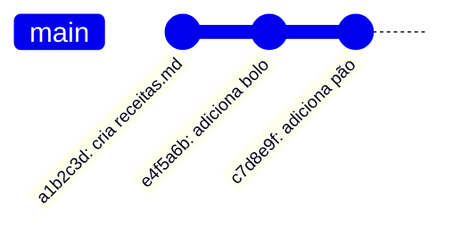

## Conceito

Um **commit** é uma foto do projeto inteiro em um momento, com:

- um **identificador único** (*hash*), como `3f9a2c1e...` (geralmente abreviado para 7 caracteres);
- **autor**, **data** e **mensagem**;
- um ponteiro para o **commit pai** (o anterior). É essa corrente de pais que forma o histórico.



> **Curioso sobre o hash?** O capítulo [Git por dentro](../12-por-dentro/) mostra como ele é calculado e o que existe dentro de um commit.

Fazer commit é sempre **duas etapas**:

1. `git add` – escolhe o que entra (área de preparação);
2. `git commit` – grava a foto no histórico.

### Quando commitar?

Faça um commit para cada **mudança lógica completa e pequena**: "adiciona receita de bolo", "corrige ingredientes do pão". Commits pequenos são fáceis de entender, revisar e desfazer.

### Como escrever a mensagem

- Verbo no presente, descrevendo o que o commit faz: `adiciona receita de bolo`.
- Curta (até ~50 caracteres) na primeira linha.
- Evite `ajustes`, `update`, `wip`. Daqui a seis meses ninguém vai saber o que significa.

## Mão na massa

Continuando de onde paramos (`receitas.md` já preparado):

```bash
git commit -m "cria arquivo de receitas"
```

```text
[main (root-commit) a1b2c3d] cria arquivo de receitas
 1 file changed, 1 insertion(+)
 create mode 100644 receitas.md
```

Edite o arquivo, acrescentando uma linha:

```bash
echo "## Bolo de cenoura" >> receitas.md
git status
```

O arquivo agora aparece como **modified**. Veja *exatamente* o que mudou:

```bash
git diff
```

```diff
 # Minhas receitas
+## Bolo de cenoura
```

Prepare e confira o que está preparado:

```bash
git add receitas.md
git diff            # vazio: nada fora da preparação
git diff --staged   # mostra o que vai entrar no commit
git commit -m "adiciona bolo de cenoura"
```

### Vendo o histórico

```bash
git log
git log --oneline            # uma linha por commit
git log --oneline --graph --all   # desenha branches (útil a partir do cap. 4)
```

```text
e4f5a6b (HEAD -> main) adiciona bolo de cenoura
a1b2c3d cria arquivo de receitas
```

Para ver o conteúdo de um commit específico:

```bash
git show e4f5a6b
```

### Atalhos úteis

```bash
git add .             # prepara todas as alterações da pasta atual
git commit -am "msg"  # prepara arquivos JÁ rastreados e commita (não pega arquivos novos)
```

### Ignorando arquivos com .gitignore

Alguns arquivos nunca devem ir para o repositório: senhas, arquivos gerados, dependências baixadas, lixo do sistema. Liste-os em um arquivo chamado `.gitignore` na raiz:

```gitignore
# arquivos do sistema
.DS_Store
Thumbs.db

# segredos
.env

# pastas geradas
node_modules/
build/
*.log
```

```bash
git add .gitignore
git commit -m "adiciona gitignore"
```

> **Atenção:** `.gitignore` só afeta arquivos ainda **não rastreados**. Se um arquivo já foi commitado, pare de rastreá-lo com `git rm --cached arquivo` e depois commite.

## O que observar

- O commit só contém o que estava **preparado**. Alterações não adicionadas ficam de fora.
- `git diff` compara diretório de trabalho com preparação; `git diff --staged` compara preparação com o último commit.
- Em `git log`, `HEAD -> main` indica onde você está (veremos no próximo capítulo).

## Resumo

| Comando | Para quê |
|---|---|
| `git commit -m "msg"` | grava a área de preparação como novo commit |
| `git log --oneline` | histórico resumido |
| `git show <hash>` | detalhes de um commit |
| `git diff` / `git diff --staged` | o que mudou e ainda não foi preparado / o que foi preparado |
| `.gitignore` | lista de arquivos que o Git deve ignorar |

## Teste-se

<details><summary>Você editou a.txt e b.txt, mas só rodou git add a.txt. O que entra no commit?</summary>
Só as alterações de <code>a.txt</code>. As de <code>b.txt</code> continuam no diretório de trabalho, como "modified".
</details>

<details><summary>Por que preferir commits pequenos?</summary>
São mais fáceis de entender no histórico, de revisar em equipe e de desfazer sem levar junto alterações que você queria manter.
</details>
