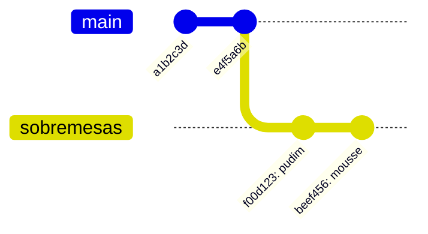

## Conceito

### Por que branches?

Imagine que o `main` é a versão "oficial" das receitas. Você quer testar uma seção nova de sobremesas sem bagunçar o que já funciona. Um **branch** (ramo) é uma linha de trabalho separada: você faz quantos commits quiser nele e, se der certo, junta ao `main` depois. Se der errado, joga fora.

### O que um branch realmente é

Um branch é só um **ponteiro leve para um commit**. Criar um branch não copia arquivos; é instantâneo. Quando você faz um commit em um branch, o ponteiro avança para o novo commit.

### O que é HEAD

**HEAD** é o ponteiro que indica "onde você está agora". Normalmente ele aponta para um branch, que aponta para um commit:

```text
HEAD → main → e4f5a6b
```

Quando você troca de branch, o Git move o HEAD e **atualiza os arquivos** do diretório de trabalho para refletir aquele branch.



No desenho, `main` continua em `e4f5a6b`, e `sobremesas` avançou dois commits.

## Mão na massa

Liste os branches (o `*` marca o atual):

```bash
git branch
# * main
```

Crie um branch e mude para ele:

```bash
git branch sobremesas     # cria
git switch sobremesas     # muda para ele
```

Ou faça as duas coisas de uma vez:

```bash
git switch -c sobremesas
```

> **Comando antigo:** você vai ver muito `git checkout nome` e `git checkout -b nome` em tutoriais. Fazem o mesmo que `git switch` / `git switch -c`. O `switch` foi criado por ser mais claro.

Trabalhe no branch:

```bash
echo "## Pudim" >> receitas.md
git commit -am "adiciona pudim"
git log --oneline --graph --all
```

```text
* f00d123 (HEAD -> sobremesas) adiciona pudim
* e4f5a6b (main) adiciona bolo de cenoura
* a1b2c3d cria arquivo de receitas
```

Volte para o `main` e olhe o arquivo:

```bash
git switch main
cat receitas.md   # o pudim sumiu!
git switch sobremesas
cat receitas.md   # voltou
```

Nada se perdeu: cada branch mostra a sua versão do projeto.

### Trocando de branch com alterações pendentes

Se você tem alterações não commitadas que entrariam em conflito com o outro branch, o Git **recusa a troca** para não perder seu trabalho. Opções: commitar antes, ou guardar temporariamente com `git stash` (veja o capítulo *Desfazendo coisas*).

## O que observar

- O `(HEAD -> sobremesas)` no log mostra que HEAD aponta para `sobremesas`.
- Trocar de branch muda os arquivos no disco. É por isso que é bom ter o diretório de trabalho limpo (`git status` sem pendências) antes de trocar.
- Branches são baratos: crie um para cada tarefa.

## Resumo

| Comando | Para quê |
|---|---|
| `git branch` | lista branches |
| `git branch <nome>` | cria branch no commit atual |
| `git switch <nome>` | muda para o branch |
| `git switch -c <nome>` | cria e muda |
| `git log --oneline --graph --all` | desenha todos os branches |

## Teste-se

<details><summary>Criar um branch duplica os arquivos do projeto?</summary>
Não. Um branch é apenas um ponteiro para um commit. Os arquivos só mudam no disco quando você troca de branch.
</details>

<details><summary>O que HEAD representa?</summary>
A sua posição atual: normalmente o branch em que você está. O próximo commit será criado a partir de onde HEAD aponta.
</details>
