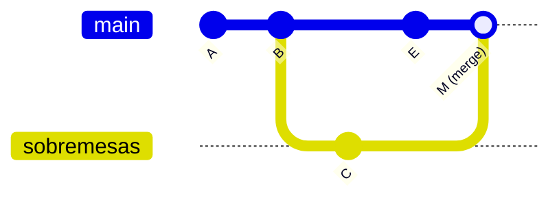

## Conceito

**Merge** é trazer os commits de um branch para outro. Você sempre faz o merge **a partir do branch que vai receber** as alterações:

```bash
git switch main          # vou receber
git merge sobremesas     # o que vou trazer
```

Existem dois tipos, e o Git escolhe sozinho:

### 1. Fast-forward (avanço rápido)

Acontece quando o `main` **não andou** desde que o branch foi criado. O Git só precisa "empurrar" o ponteiro `main` para frente. Nenhum commit novo é criado.

```text
Antes:   A ── B (main)
               └── C ── D (sobremesas)

Depois:  A ── B ── C ── D (main, sobremesas)
```

### 2. Three-way (de três vias)

Acontece quando **os dois branches andaram**. O Git compara três versões (o ancestral comum e as pontas dos dois branches) e cria um **commit de merge**, que tem dois pais.



Se os dois lados mudaram **as mesmas linhas** do mesmo arquivo, ocorre um *conflito*, assunto do capítulo 8.

## Mão na massa

### Merge fast-forward

Você está com o branch `sobremesas` à frente do `main` (capítulo anterior):

```bash
git switch main
git merge sobremesas
```

```text
Updating e4f5a6b..f00d123
Fast-forward
 receitas.md | 1 +
```

### Excluindo o branch

Fazer merge **não apaga** o branch. Se o trabalho acabou:

```bash
git branch -d sobremesas
```

O `-d` só exclui se o branch já foi integrado (proteção contra perda). Para forçar a exclusão de um branch não integrado: `-D` (cuidado).

### Merge three-way

Crie divergência de propósito:

```bash
git switch -c salgados
echo "## Coxinha" >> salgados.md
git add salgados.md
git commit -m "adiciona coxinha"

git switch main
echo "Receitas testadas em casa." >> sobre.md
git add sobre.md
git commit -m "adiciona sobre"

git merge salgados
```

O Git abre o editor com a mensagem `Merge branch 'salgados'`. Salve e feche. Depois:

```bash
git log --oneline --graph
```

```text
*   9a8b7c6 (HEAD -> main) Merge branch 'salgados'
|\
| * 1c2d3e4 (salgados) adiciona coxinha
* | 5f6a7b8 adiciona sobre
|/
* f00d123 adiciona pudim
```

### Visitando um commit antigo (HEAD destacado)

Você pode ir a qualquer commit para ver como o projeto era:

```bash
git switch --detach a1b2c3d     # ou: git checkout a1b2c3d
```

O Git avisa que você está em **detached HEAD**: o HEAD aponta direto para um commit, não para um branch. Pode olhar à vontade; se fizer commits aqui e quiser mantê-los, crie um branch (`git switch -c nome`). Para voltar:

```bash
git switch main
```

## O que observar

- No fast-forward nenhum commit novo aparece; no three-way surge um commit de merge com dois pais (o desenho em "losango" no `--graph`).
- `git branch -d` recusa apagar branches com trabalho não integrado. Isso é uma proteção, não um erro.

## Resumo

| Comando | Para quê |
|---|---|
| `git merge <branch>` | traz o branch para o branch atual |
| `git branch -d <branch>` | exclui branch já integrado |
| `git switch --detach <hash>` | visita um commit antigo |

## Teste-se

<details><summary>Quando o Git faz fast-forward?</summary>
Quando o branch que recebe não tem commits novos desde que o outro branch foi criado. Basta mover o ponteiro, sem criar commit de merge.
</details>

<details><summary>Você está no branch feature e roda git merge main. Quem recebe as alterações?</summary>
O <code>feature</code>. O merge sempre traz o branch citado para o branch atual.
</details>
