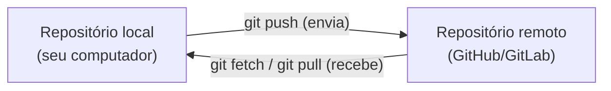

## Conceito

Até aqui tudo viveu só no seu computador. Um **repositório remoto** é uma cópia do repositório hospedada em outro lugar, geralmente em um serviço como **GitHub**, **GitLab** ou **Bitbucket**. Ele serve para:

1. **Backup**: se seu computador quebrar, o histórico está a salvo.
2. **Colaboração**: várias pessoas sincronizam com o mesmo remoto.
3. **Publicação**: compartilhar o projeto (inclusive como site, como este guia).



### Duas formas de começar um projeto

- **Você já tem um repositório local** → cria um remoto vazio e faz *push* (este capítulo).
- **O projeto já existe no remoto** → faz *clone* (próximo capítulo).

### Nomes importantes

- **`origin`**: apelido padrão do remoto principal. É só um nome; poderia ser outro.
- **`origin/main`**: *remote-tracking branch*, a lembrança local de onde o `main` estava no remoto na última vez que você sincronizou. Você não faz commits nele; o Git o atualiza.

## Mão na massa

### 1. Crie uma conta

Crie uma conta gratuita no [GitHub](https://github.com) (os passos são parecidos no GitLab e no Bitbucket).

### 2. Configure a autenticação via SSH

O serviço precisa saber que é você quem está enviando. A forma mais prática é uma **chave SSH**: um par de arquivos, um privado (fica no seu computador, nunca compartilhe) e um público (vai para o site).

```bash
# gera o par de chaves (aperte Enter para aceitar o local padrão; defina uma senha se quiser)
ssh-keygen -t ed25519 -C "voce@exemplo.com"

# mostra a chave PÚBLICA para copiar
cat ~/.ssh/id_ed25519.pub
```

No GitHub: **Settings → SSH and GPG keys → New SSH key**, cole o conteúdo e salve. Teste:

```bash
ssh -T git@github.com
# Hi seu-usuario! You've successfully authenticated...
```

> **Alternativa HTTPS:** em vez de SSH, você pode usar a URL `https://` e, quando pedir senha, informar um *Personal Access Token* (Settings → Developer settings). Senhas comuns não funcionam mais para Git no GitHub.

### 3. Crie o repositório remoto

No GitHub: **New repository**, nome `receitas`, **sem** marcar "Add a README" (o remoto deve começar vazio, já que seu histórico está local). Copie a URL SSH, algo como `git@github.com:seu-usuario/receitas.git`.

### 4. Conecte e envie

```bash
git remote add origin git@github.com:seu-usuario/receitas.git
git remote -v     # confere
git push -u origin main
```

O `-u` (ou `--set-upstream`) liga o seu `main` local ao `origin/main`. Depois disso, basta:

```bash
git push
```

Atualize a página do repositório no navegador: seus arquivos e commits estão lá.

### Envie outros branches

```bash
git switch -c bebidas
echo "## Limonada" >> bebidas.md
git add bebidas.md
git commit -m "adiciona limonada"
git push -u origin bebidas
```

## O que observar

- `git log --oneline --all` agora mostra também `origin/main`. Ele só se move quando você faz push, fetch ou pull.
- `git status` passa a dizer coisas como `Your branch is up to date with 'origin/main'` ou `ahead of 'origin/main' by 2 commits` (você tem 2 commits que o remoto ainda não tem).
- Push só envia **commits**. Alterações não commitadas não vão.

## Resumo

| Comando | Para quê |
|---|---|
| `ssh-keygen -t ed25519` | cria chave SSH |
| `git remote add origin <url>` | registra o remoto |
| `git remote -v` | lista remotos |
| `git push -u origin <branch>` | primeiro envio, liga ao upstream |
| `git push` | envia commits do branch atual |

## Teste-se

<details><summary>Qual chave você cola no GitHub: id_ed25519 ou id_ed25519.pub?</summary>
A pública, <code>id_ed25519.pub</code>. A privada nunca sai do seu computador.
</details>

<details><summary>O que significa "Your branch is ahead of 'origin/main' by 3 commits"?</summary>
Você tem 3 commits locais que ainda não foram enviados. Um <code>git push</code> resolve.
</details>
