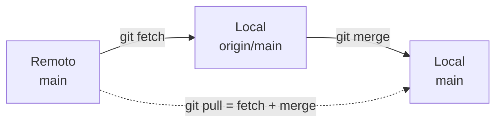

## Conceito

### Clone

`git clone` baixa um repositório remoto **inteiro** (todos os commits e branches) e já configura o `origin`. É assim que você entra em um projeto que já existe.

### Fetch × Pull

Essa é uma das dúvidas mais comuns:

| | `git fetch` | `git pull` |
|---|---|---|
| Baixa commits novos do remoto | sim | sim |
| Atualiza `origin/main` | sim | sim |
| Altera o seu `main` e seus arquivos | **não** | **sim** |
| Equivale a | só baixar | `fetch` + `merge` |

`fetch` é seguro: só olha. `pull` traz e integra.



### Upstream

O **branch upstream** é o branch remoto ao qual seu branch local está ligado. Com ele configurado, `git push` e `git pull` sem argumentos sabem para onde ir, e o `git status` mostra se você está à frente ou atrás.

## Mão na massa

Simule uma segunda pessoa clonando o projeto em outra pasta:

```bash
cd ~
git clone git@github.com:seu-usuario/receitas.git receitas-colega
cd receitas-colega
git branch -a
```

```text
* main
  remotes/origin/HEAD -> origin/main
  remotes/origin/bebidas
  remotes/origin/main
```

O clone cria só o `main` local, mas conhece todos os branches remotos. Para trabalhar no `bebidas`:

```bash
git switch bebidas   # cria o branch local ligado a origin/bebidas automaticamente
```

Veja os upstreams:

```bash
git branch -vv
```

### Recebendo alterações

No GitHub, edite `receitas.md` pelo navegador (ícone de lápis) e faça commit lá. Depois, de volta na pasta original:

```bash
cd ~/receitas
git switch main
git fetch
git status
# Your branch is behind 'origin/main' by 1 commit, and can be fast-forwarded.
git log --oneline main..origin/main   # o que chegou e ainda não está no seu main
git merge                             # integra (fast-forward)
```

Da próxima vez, faça tudo de uma vez:

```bash
git pull
```

### Excluindo branches

Depois que `bebidas` foi integrado e não é mais necessário:

```bash
git branch -d bebidas                # apaga o local
git push origin --delete bebidas     # apaga no remoto
```

Se outra pessoa apagou um branch no remoto, sua cópia ainda guarda `origin/bebidas`. Limpe com:

```bash
git fetch --prune
```

## O que observar

- `git fetch` nunca mexe nos seus arquivos. Use à vontade para "espiar" o remoto.
- `main..origin/main` lê-se "commits que estão em `origin/main` e não estão em `main`".
- Rode `git pull` **antes** de começar a trabalhar todos os dias: menos chance de conflito.

## Resumo

| Comando | Para quê |
|---|---|
| `git clone <url> [pasta]` | copia um repositório remoto |
| `git fetch` | baixa novidades sem integrar |
| `git pull` | baixa e integra (fetch + merge) |
| `git branch -vv` | mostra upstream de cada branch |
| `git push origin --delete <b>` | apaga branch remoto |
| `git fetch --prune` | remove referências a branches remotos apagados |

## Teste-se

<details><summary>Você quer ver o que mudou no remoto sem alterar nada local. Qual comando?</summary>
<code>git fetch</code>, seguido de <code>git log main..origin/main</code> ou <code>git diff main origin/main</code>.
</details>

<details><summary>Depois de clonar, por que git branch mostra só main?</summary>
O clone cria localmente apenas o branch padrão. Os outros ficam como <code>origin/&lt;nome&gt;</code>; um <code>git switch &lt;nome&gt;</code> cria o branch local correspondente.
</details>
