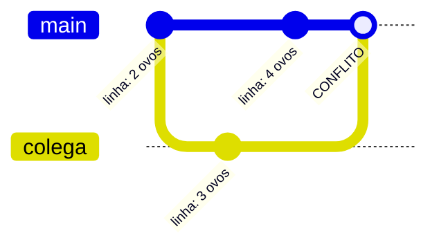

## Conceito

Um **conflito** acontece quando dois branches alteraram **as mesmas linhas** do mesmo arquivo (ou um apagou um arquivo que o outro editou). O Git não sabe qual versão é a certa e **pede para você decidir**.

Conflito não é erro nem sinal de que algo quebrou. É o Git sendo honesto: "isso eu não decido sozinho".



### Os marcadores

O Git escreve as duas versões dentro do arquivo:

```text
<<<<<<< HEAD
- 4 ovos
=======
- 3 ovos
>>>>>>> colega
```

| Trecho | Significado |
|---|---|
| entre `<<<<<<< HEAD` e `=======` | a sua versão (branch atual) |
| entre `=======` e `>>>>>>> colega` | a versão que está chegando |

### O processo (sempre o mesmo)

1. **Identifique**: `git status` lista os arquivos em *both modified*.
2. **Edite**: abra cada arquivo, escolha o conteúdo final e **apague os três marcadores**.
3. **Marque como resolvido**: `git add <arquivo>`.
4. **Finalize**: `git commit` (o Git já sugere a mensagem de merge).

Se travar: `git merge --abort` volta tudo para antes do merge.

## Mão na massa

Monte um conflito no seu repositório `receitas`:

```bash
git switch main
echo "- 2 ovos" >> receitas.md
git commit -am "ingredientes do bolo"

git switch -c colega
sed -i 's/- 2 ovos/- 3 ovos/' receitas.md   # no macOS: sed -i '' 's/.../.../' receitas.md
git commit -am "bolo com 3 ovos"

git switch main
sed -i 's/- 2 ovos/- 4 ovos/' receitas.md
git commit -am "bolo com 4 ovos"

git merge colega
```

```text
Auto-merging receitas.md
CONFLICT (content): Merge conflict in receitas.md
Automatic merge failed; fix conflicts and then commit the result.
```

Passo 1, identifique:

```bash
git status
# both modified:   receitas.md
```

Passo 2, abra `receitas.md` e deixe só o que deve ficar, por exemplo:

```text
- 3 ovos
```

> **Dica:** o VS Code mostra botões *Accept Current*, *Accept Incoming* e *Accept Both* acima de cada conflito. São atalhos para essa edição.

Passos 3 e 4:

```bash
git add receitas.md
git commit       # salve a mensagem sugerida
git log --oneline --graph
```

### Conflitos ao fazer pull

O mesmo acontece quando você roda `git pull` e alguém mudou as mesmas linhas no remoto. O processo é idêntico; depois do commit, faça `git push`.

## Como ter menos conflitos

- Faça `git pull` com frequência e antes de começar a trabalhar.
- Commits e branches pequenos e de vida curta.
- Combine com a equipe quem mexe em quê.
- Evite reformatar arquivos inteiros (trocar indentação gera conflito em tudo).

## O que observar

- Enquanto houver conflito, `git status` mostra `You have unmerged paths`.
- Esqueceu um marcador `<<<<<<<` no arquivo? O Git deixa você commitar mesmo assim. Revise antes do `git add`; `git diff` ajuda.

## Resumo

| Comando | Para quê |
|---|---|
| `git status` | lista arquivos em conflito |
| `git add <arquivo>` | marca conflito como resolvido |
| `git commit` | conclui o merge |
| `git merge --abort` | desiste e volta ao estado anterior |

## Teste-se

<details><summary>O que vem entre &lt;&lt;&lt;&lt;&lt;&lt;&lt; HEAD e =======?</summary>
A versão do branch em que você está (o que recebe o merge).
</details>

<details><summary>Você resolveu o arquivo mas o git status ainda mostra conflito. O que faltou?</summary>
Rodar <code>git add</code> no arquivo para marcá-lo como resolvido.
</details>
