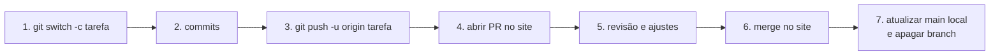

## Conceito

Um **pull request** (PR; no GitLab chama-se *merge request*) é um pedido feito no serviço de hospedagem: "por favor, revisem e integrem meu branch no `main`". Não é um comando do Git, é um recurso do GitHub/GitLab/Bitbucket.

Por que usar:

- **Revisão de código**: outra pessoa lê antes de entrar no `main`.
- **Discussão**: comentários linha a linha ficam registrados.
- **Automação**: testes rodam antes do merge.
- **Proteção**: o `main` só recebe código revisado.

### O fluxo completo



### Formas de integrar o PR

O botão de merge geralmente oferece três opções:

| Opção | Resultado no `main` |
|---|---|
| **Create a merge commit** | todos os commits do branch + um commit de merge |
| **Squash and merge** | um único commit com todas as alterações |
| **Rebase and merge** | os commits do branch replantados, sem commit de merge |

## Mão na massa

### 1 a 3: crie o branch e envie

```bash
git switch main
git pull
git switch -c massas
echo "## Lasanha" >> massas.md
git add massas.md
git commit -m "adiciona lasanha"
git push -u origin massas
```

> **Atalho:** para não precisar digitar `-u origin <branch>` toda vez, configure `git config --global push.autoSetupRemote true`. Aí um simples `git push` cria o upstream.

### 4: abra o PR

O próprio `git push` imprime um link do tipo `https://github.com/seu-usuario/receitas/pull/new/massas`. Abra-o (ou clique em **Compare & pull request** no site), escreva:

- **Título**: o que o PR faz.
- **Descrição**: por que, como testar, prints se houver.

Pelo terminal, com a [GitHub CLI](https://cli.github.com):

```bash
gh pr create --base main --title "Adiciona lasanha" --body "Primeira receita de massas."
```

### 5: revisão

O revisor comenta na aba **Files changed** e aprova ou pede alterações. Para ajustar, basta continuar commitando no mesmo branch e dar `git push`: o PR se atualiza sozinho.

### 6: merge

Com aprovação, clique em **Merge pull request** e depois em **Delete branch** para apagar o branch remoto.

### 7: sincronize e limpe

```bash
git switch main
git pull                 # traz o merge
git branch -d massas     # apaga o local
git fetch --prune        # some com o origin/massas
```

> **Se usou squash:** o `git branch -d` pode recusar, porque o commit no `main` é diferente dos seus. Confira que o PR foi integrado e use `git branch -D massas`.

## O que observar

- Um PR é sempre de **um branch para outro**. Um branch por tarefa, um PR por branch.
- PRs pequenos são revisados mais rápido e com mais qualidade.
- Contribuindo em projeto de outra pessoa? Primeiro faça um **fork** (sua cópia do repositório no site), trabalhe nele e abra o PR do fork para o original.

## Resumo

| Etapa | Comando / ação |
|---|---|
| criar branch | `git switch -c <tarefa>` |
| enviar | `git push -u origin <tarefa>` |
| abrir PR | botão no site ou `gh pr create` |
| ajustar | novos commits + `git push` |
| integrar | botão *Merge* no site |
| limpar | `git switch main && git pull && git branch -d <tarefa>` |

## Teste-se

<details><summary>Pull request é um comando do Git?</summary>
Não. É um recurso dos serviços de hospedagem. O Git só fornece branches, push e merge; o PR organiza a revisão em volta disso.
</details>

<details><summary>O revisor pediu uma mudança. Precisa abrir outro PR?</summary>
Não. Faça novos commits no mesmo branch e dê push; o PR aberto é atualizado.
</details>
