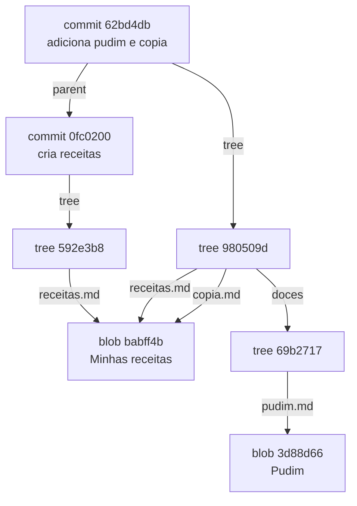

Até aqui você usou os comandos do dia a dia, que o Git chama de **porcelana** (*porcelain*). Por baixo deles existem comandos de baixo nível, o **encanamento** (*plumbing*), que manipulam diretamente o banco de dados do Git. Entender essa camada faz tudo o que você aprendeu "fazer sentido".

> **Pré-requisito:** capítulos 1 a 5. Faça os exercícios em uma pasta nova, separada do projeto `receitas`.

## A grande ideia: um banco chave-valor

No fundo, o Git é um **banco de dados de conteúdo endereçável**: você entrega um conteúdo, ele guarda e devolve uma **chave**, que é o **hash** desse conteúdo. Com a chave, você recupera o conteúdo.

Tudo que o Git guarda (arquivos, pastas, commits, tags) vira um **objeto** dentro de `.git/objects`, identificado pelo seu hash.

## O hash SHA-1

O Git calcula a chave com a função **SHA-1**, que transforma qualquer conteúdo em 40 caracteres hexadecimais. Três propriedades importam:

1. **Determinístico**: o mesmo conteúdo gera sempre o mesmo hash, em qualquer computador.
2. **Muda tudo com qualquer mudança**: alterar um único caractere produz um hash completamente diferente.
3. **Na prática, único**: dois conteúdos diferentes não geram o mesmo hash.

Faça o teste:

```bash
mkdir laboratorio && cd laboratorio
git init
echo "# Minhas receitas" | git hash-object --stdin
```

```text
babff4bc7f99d5136e64fa37f4eac84e59d44b90
```

**O seu resultado é exatamente esse.** Não importa quem você é, nem a data, nem o computador: mesmo conteúdo, mesmo hash.

### O que exatamente entra no hash

O Git não calcula o hash só do conteúdo. Ele monta um cabeçalho `tipo tamanho\0` e calcula o SHA-1 do conjunto. Dá para reproduzir sem o Git:

```bash
printf 'blob 18\0# Minhas receitas\n' | sha1sum
# babff4bc7f99d5136e64fa37f4eac84e59d44b90  -
```

`blob` é o tipo, `18` é o tamanho em bytes (17 caracteres + a quebra de linha) e `\0` é um byte nulo separador.

### SHA-1 é seguro?

Em 2017 pesquisadores produziram a primeira colisão prática de SHA-1 (o ataque *SHAttered*). O Git reagiu de duas formas:

- desde a versão 2.13 usa uma versão **endurecida** do SHA-1, que detecta e rejeita os padrões conhecidos de ataque;
- suporta repositórios com **SHA-256** (`git init --object-format=sha256`), com hashes de 64 caracteres. A adoção ainda é pequena, porque os serviços de hospedagem e ferramentas precisam acompanhar.

Para o seu uso diário, o hash do Git é um **identificador** e uma **verificação de integridade**: se um único bit de um objeto se corromper, o hash deixa de bater e o Git percebe.

## Os quatro tipos de objeto

| Objeto | Guarda | Analogia |
|---|---|---|
| **blob** | o conteúdo de um arquivo (sem o nome!) | o texto de uma página |
| **tree** | uma pasta: lista de nomes, permissões e hashes de blobs e outras trees | o índice de uma pasta |
| **commit** | uma tree raiz, o(s) commit(s) pai, autor, data e mensagem | a foto com legenda |
| **tag** (anotada) | aponta para um objeto, com nome, autor, data e mensagem | a etiqueta colada na foto |



O desenho acima é exatamente o que você vai construir a seguir. Repare: `receitas.md` e `copia.md` apontam para **o mesmo blob**.

## Mão na massa: espiando os objetos

### 1. O blob

Ainda na pasta `laboratorio`:

```bash
echo "# Minhas receitas" > receitas.md
git add receitas.md
find .git/objects -type f
```

```text
.git/objects/ba/bff4bc7f99d5136e64fa37f4eac84e59d44b90
```

O `git add` **já gravou o blob**. Os dois primeiros caracteres do hash viram o nome da pasta (para não ter milhares de arquivos em um só diretório) e o resto vira o nome do arquivo.

Use `git cat-file` para inspecionar qualquer objeto:

```bash
git cat-file -t babff4b   # tipo
git cat-file -s babff4b   # tamanho
git cat-file -p babff4b   # conteúdo formatado
```

```text
blob
18
# Minhas receitas
```

> **Por dentro do arquivo:** o objeto é gravado comprimido com **zlib**. Descomprimindo, aparece exatamente o que entrou no hash: `blob 18\0# Minhas receitas\n`.

O blob **não tem nome de arquivo**. Por isso renomear um arquivo não cria um blob novo: o conteúdo é o mesmo.

### 2. O commit e a tree

```bash
git commit -m "cria receitas"
git cat-file -p HEAD
```

```text
tree 592e3b888b9636d1d9e2c9b33da66c3afd955ff3
author Ana <ana@exemplo.com> 1768050000 -0300
committer Ana <ana@exemplo.com> 1768050000 -0300

cria receitas
```

Um commit é só um texto curto: a tree raiz, autor, quem fez o commit (com data em segundos desde 1970 e fuso), uma linha em branco e a mensagem. Esse primeiro commit não tem `parent`, porque é a raiz do histórico.

Agora a tree:

```bash
git cat-file -p 592e3b8
```

```text
100644 blob babff4bc7f99d5136e64fa37f4eac84e59d44b90	receitas.md
```

Cada linha é **modo, tipo, hash e nome**. Os modos mais comuns:

| Modo | Significado |
|---|---|
| `100644` | arquivo normal |
| `100755` | arquivo executável |
| `120000` | link simbólico |
| `040000` | subpasta (outra tree) |

> **Seus hashes:** o blob e a tree terão os mesmos hashes que aparecem aqui, porque dependem só do conteúdo. O **commit** terá outro hash, porque inclui o seu nome, e-mail e data.

### 3. Subpastas e deduplicação

```bash
mkdir doces
echo "## Pudim" > doces/pudim.md
cp receitas.md copia.md
git add .
git commit -m "adiciona pudim e copia"

git cat-file -p HEAD
git cat-file -p HEAD^{tree}
git cat-file -p HEAD^{tree}:doces
```

```text
tree 980509d06a8400778932413197fdbad07ed8e4dc
parent 0fc0200e26c957b3df486276524e9cc1b177c9aa
author Ana <ana@exemplo.com> 1768050000 -0300
...

100644 blob babff4bc7f99d5136e64fa37f4eac84e59d44b90	copia.md
040000 tree 69b2717f194ee8b44912b1209aa11fd6d7644ca9	doces
100644 blob babff4bc7f99d5136e64fa37f4eac84e59d44b90	receitas.md

100644 blob 3d88d66a5e2e9229db6bf27e5eea71845ca1723a	pudim.md
```

O que observar:

- O segundo commit tem `parent`: é assim que a corrente do histórico é formada.
- A pasta `doces` virou uma tree dentro da tree raiz.
- `copia.md` e `receitas.md` têm o **mesmo hash**: o Git guardou o conteúdo uma única vez.
- O blob de `receitas.md` do primeiro commit foi **reaproveitado**. Um commit não copia o projeto inteiro: arquivos que não mudaram apontam para os mesmos blobs de antes.

Conte os objetos:

```bash
git count-objects -v
# count: 7
```

São 7: 2 commits, 3 trees (raiz do primeiro commit, raiz do segundo e `doces`) e 2 blobs. Mesmo com 3 arquivos no último commit, só existem 2 conteúdos diferentes.

### 4. A tag anotada

```bash
git tag leve                          # tag leve: só uma ref
git tag -a v1.0 -m "primeira versao"  # tag anotada: cria um objeto
git cat-file -t v1.0
git cat-file -p v1.0
```

```text
tag
object 62bd4dbba9d0ae047a9bc89caadfcc7679b75e2b
type commit
tag v1.0
tagger Ana <ana@exemplo.com> 1768050000 -0300

primeira versao
```

A tag leve é só um nome apontando para o commit. A anotada é um objeto de verdade, com autor, data e mensagem. Para versões publicadas, prefira a anotada.

## Por que o histórico é imutável

Junte as peças:

- o hash do **blob** depende do conteúdo do arquivo;
- o hash da **tree** depende dos hashes dos blobs e trees que ela lista;
- o hash do **commit** depende da tree **e do hash do pai**.

Alterar qualquer coisa no passado muda o hash daquele commit, o que muda o hash do filho, e do neto, até a ponta. É uma corrente em que cada elo "assina" o anterior (a mesma ideia de uma *árvore de Merkle*).

Consequências que você já viu:

- **Rebase, amend e reset** não "editam" commits: criam commits novos com hashes novos (capítulos 9 e 11).
- Conhecer o hash da ponta de um branch é suficiente para garantir que todo o histórico abaixo dele está íntegro.
- Commits nunca são alterados; no máximo deixam de ser apontados por algum branch.

## Refs: nomes para hashes

Ninguém quer digitar `62bd4dbba9d0...`. As **refs** são arquivos de texto que guardam um hash com um nome amigável:

```bash
cat .git/HEAD
cat .git/refs/heads/main
```

```text
ref: refs/heads/main
62bd4dbba9d0ae047a9bc89caadfcc7679b75e2b
```

| Ref | Onde fica | Conteúdo |
|---|---|---|
| branch `main` | `.git/refs/heads/main` | hash do commit da ponta |
| tag `v1.0` | `.git/refs/tags/v1.0` | hash do commit (leve) ou do objeto tag (anotada) |
| `origin/main` | `.git/refs/remotes/origin/main` | hash da ponta do `main` remoto na última sincronização |
| `HEAD` | `.git/HEAD` | normalmente `ref: refs/heads/<branch>`; em detached HEAD, um hash direto |

Agora os capítulos anteriores ficam óbvios:

- **Criar um branch** = criar um arquivo de 41 bytes com um hash. Por isso é instantâneo.
- **Fazer commit** = criar objetos e reescrever o arquivo do branch atual com o novo hash.
- **Fast-forward** = trocar o hash dentro do arquivo do branch por um mais à frente.
- **Detached HEAD** = `.git/HEAD` contém um hash em vez de `ref: ...`.
- **Apagar um branch** = apagar o arquivo da ref. Os commits continuam em `.git/objects`.

> **Atenção:** depois de um `git gc`, as refs podem ser movidas para um único arquivo, `.git/packed-refs`. Por isso, nunca edite refs à mão; use os comandos.

### Apelidos para chegar a commits

| Expressão | Significa |
|---|---|
| `HEAD~1` ou `HEAD~` | o pai de HEAD |
| `HEAD~3` | o bisavô (seguindo sempre o primeiro pai) |
| `HEAD^2` | o **segundo** pai (só existe em commits de merge) |
| `main^{tree}` | a tree do commit apontado por `main` |
| `main:doces/pudim.md` | o blob desse arquivo naquele commit |

Teste com `git rev-parse`, que traduz qualquer expressão para o hash:

```bash
git rev-parse HEAD~1
git rev-parse --short HEAD
```

## O index por dentro

A área de preparação é um arquivo binário, `.git/index`. Ela guarda a lista de arquivos que formarão a **próxima tree**: caminho, modo, hash do blob e dados para detectar mudanças rapidamente (tamanho, data de modificação).

```bash
git ls-files --stage
```

```text
100644 babff4bc7f99d5136e64fa37f4eac84e59d44b90 0	copia.md
100644 3d88d66a5e2e9229db6bf27e5eea71845ca1723a 0	doces/pudim.md
100644 babff4bc7f99d5136e64fa37f4eac84e59d44b90 0	receitas.md
```

O `0` é o **estágio**. Durante um conflito de merge, o mesmo arquivo aparece em três estágios:

```text
100644 10d10c38413dc9a8423f2ff779cf6f1e1dd9b413 1	bolo.md   ← ancestral comum
100644 1896d20de7f7fbdf712e0c4dcdd87ce8ab4cede3 2	bolo.md   ← nossa versão (HEAD)
100644 d48b223bfa4b3eaaea4a54aadd6a397c7307170a 3	bolo.md   ← versão que está chegando
```

São as **três vias** do merge three-way. Quando você resolve o conflito e roda `git add`, os estágios 1, 2 e 3 são trocados por um único estágio 0. É isso que "marcar como resolvido" significa.

O ancestral comum pode ser consultado com:

```bash
git merge-base main outro-branch
```

## Desafio: um commit sem `git add` nem `git commit`

Vamos montar um commit usando só comandos de encanamento. Em uma pasta nova:

```bash
mkdir encanamento && cd encanamento
git init

# 1. grava um blob no banco de objetos (-w = write)
echo "## Bolo" | git hash-object -w --stdin
# 10d10c38413dc9a8423f2ff779cf6f1e1dd9b413

# 2. coloca o blob no index com um nome de arquivo
git update-index --add --cacheinfo 100644,10d10c38413dc9a8423f2ff779cf6f1e1dd9b413,bolo.md

# 3. transforma o index em uma tree
git write-tree
# 769c67206a3f8da6414b99c52d4c8c042eae40b0

# 4. cria um commit apontando para a tree (guardamos o hash na variável C;
#    o seu será diferente, porque inclui seu nome e a data)
C=$(echo "commit feito a mao" | git commit-tree 769c672)
echo $C

# 5. faz o branch main apontar para esse commit
git update-ref refs/heads/main $C

git log --oneline
```

Funciona: há um commit no histórico. Agora rode `git status`:

```text
Changes not staged for commit:
        deleted:    bolo.md
```

O arquivo está no commit e no index, mas **nunca foi escrito no diretório de trabalho**: você só mexeu no banco de dados. Traga-o com `git restore bolo.md`.

O que você acabou de fazer manualmente é o que acontece por trás de:

| Porcelana | Encanamento |
|---|---|
| `git add` | `hash-object -w` + `update-index` |
| `git commit` | `write-tree` + `commit-tree` + `update-ref` |

## Packfiles: como o Git economiza espaço

Cada versão de um arquivo vira um blob completo. Um arquivo de 100 KB alterado 50 vezes geraria 5 MB? Não, por dois motivos:

1. os objetos soltos (*loose objects*) são comprimidos com zlib;
2. periodicamente (e antes de enviar pela rede) o Git empacota os objetos em **packfiles**, guardando versões parecidas como **deltas**: uma versão completa e só as diferenças das outras.

```bash
git gc
git count-objects -v
ls .git/objects/pack
```

```text
count: 0
in-pack: 7
packs: 1

pack-ea82....idx
pack-ea82....pack
pack-ea82....rev
```

Os objetos soltos sumiram e foram para um `.pack` (os dados) com um `.idx` (índice para achar cada objeto rapidamente). Você não precisa rodar `git gc` à mão; o Git faz isso automaticamente quando há objetos soltos demais. É também um packfile que trafega no `git push`, `git fetch` e `git clone`.

## Objetos perdidos, reflog e coleta de lixo

Quando você faz `reset`, `rebase` ou apaga um branch, os commits antigos **continuam** em `.git/objects`; só deixam de ser alcançáveis por alguma ref. O **reflog** (`.git/logs/`) registra por onde as refs passaram, e é por isso que dá para recuperá-los (capítulo 11).

```bash
git fsck --unreachable   # lista objetos que nenhuma ref alcança
```

O `git gc` só apaga de vez objetos inalcançáveis **e** antigos: por padrão, entradas do reflog vivem 90 dias (30 para commits que já saíram do histórico do branch) e objetos soltos sem referência têm mais 2 semanas de carência. Na prática, você tem semanas para se arrepender.

## Mapa da pasta .git

| Caminho | O que é |
|---|---|
| `HEAD` | onde você está |
| `config` | configurações deste repositório (remotos, branches, upstreams) |
| `objects/` | o banco de objetos: soltos (`ab/cdef...`) e `pack/` |
| `refs/heads/`, `refs/tags/`, `refs/remotes/` | branches, tags e branches remotos |
| `packed-refs` | refs compactadas em um único arquivo |
| `index` | a área de preparação |
| `logs/` | o reflog |
| `hooks/` | scripts executados em eventos (ex.: `pre-commit`) |
| `description`, `info/` | arquivos auxiliares (`info/exclude` funciona como um `.gitignore` local) |

## Resumo

- O Git é um banco chave-valor: o conteúdo vira objeto e o hash SHA-1 vira a chave.
- **blob** = conteúdo, **tree** = pasta, **commit** = tree + pai + metadados, **tag** = etiqueta anotada.
- Mesmo conteúdo, mesmo hash: arquivos repetidos e não alterados são guardados uma vez só.
- Commits são imutáveis; reescrever histórico cria commits novos.
- **Refs** são arquivos com um hash dentro; branch é só isso.
- O **index** monta a próxima tree e guarda os três estágios de um conflito.
- **Packfiles** comprimem com deltas; **reflog** e **gc** decidem quando algo some de vez.

| Comando de encanamento | Para quê |
|---|---|
| `git hash-object [-w] --stdin` | calcula (e grava) o hash de um conteúdo |
| `git cat-file -t / -s / -p <obj>` | tipo, tamanho e conteúdo de um objeto |
| `git ls-tree -r <commit>` | lista recursivamente a tree de um commit |
| `git ls-files --stage` | mostra o index |
| `git write-tree` / `git commit-tree` | cria tree a partir do index / cria commit |
| `git update-ref` | move uma ref |
| `git rev-parse <expr>` | traduz nome ou expressão em hash |
| `git merge-base A B` | ancestral comum |
| `git count-objects -v` / `git gc` | estatísticas / empacota e limpa |
| `git fsck` | verifica a integridade e acha objetos inalcançáveis |

## Teste-se

<details><summary>Você renomeia um arquivo sem mudar o conteúdo e commita. Um blob novo é criado?</summary>
Não. O blob guarda só o conteúdo, que não mudou. O que muda é a tree, que passa a listar o mesmo hash com outro nome (e, por consequência, um commit novo).
</details>

<details><summary>Por que alterar a mensagem de um commit antigo muda o hash de todos os commits posteriores?</summary>
Porque a mensagem entra no hash do commit, e o hash de cada commit filho inclui o hash do pai. A mudança se propaga até a ponta.
</details>

<details><summary>Quanto espaço ocupa criar um branch novo?</summary>
Praticamente nada: um arquivo em <code>.git/refs/heads/</code> com o hash do commit (41 bytes). Nenhum arquivo do projeto é copiado.
</details>

<details><summary>Durante um conflito, o que significam os estágios 1, 2 e 3 em git ls-files --stage?</summary>
1 é o ancestral comum, 2 é a nossa versão (HEAD) e 3 é a versão que está chegando. Ao resolver e dar <code>git add</code>, eles viram um único estágio 0.
</details>

<details><summary>Você deu git branch -D sem querer. Os commits sumiram?</summary>
Não imediatamente. Os objetos continuam em <code>.git/objects</code> e o reflog guarda o hash. Recupere com <code>git reflog</code> e <code>git branch nome &lt;hash&gt;</code>.
</details>
